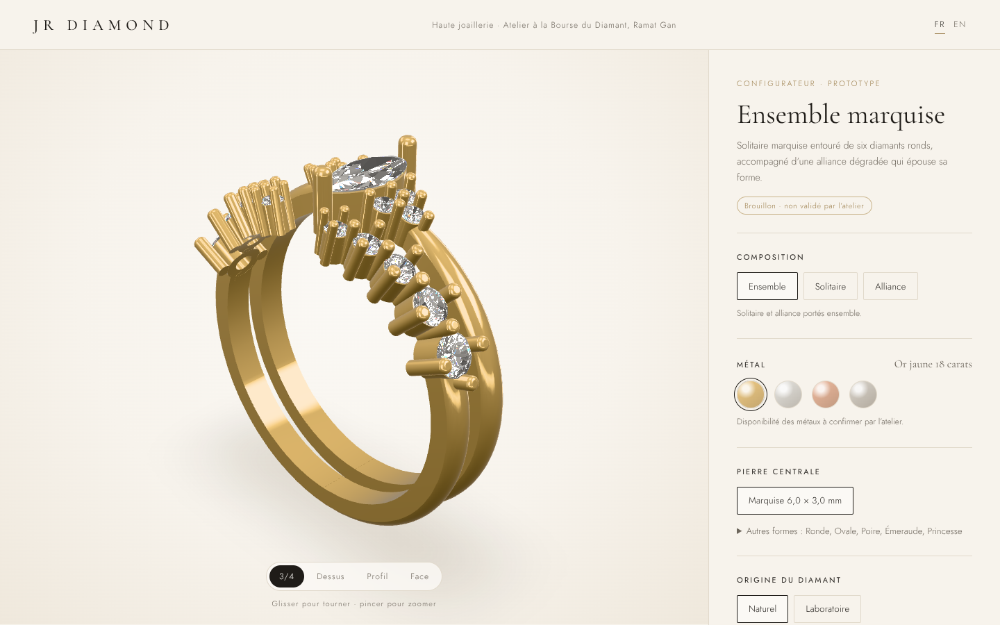

# Rapport du prototype technique — phase 2

Date : 20 octobre 2026. Modèle pilote : `Ring.3dm` (Rhino 5, ensemble de deux bagues).

Légende : **[V]** vérifié par un test ou une mesure exécutés · **[E]** estimation · **[T]** reste à tester.

## A. Prototype

- Route : `/fr/configurateur/ring-001` et `/en/configurateur/ring-001` ; la racine redirige vers la version française. Pages non indexées (`noindex`) tant que le site n'est pas validé.
- Fonctions :
  - rotation et zoom (souris, molette, un doigt pour tourner, deux doigts pour zoomer) ;
  - 4 vues prédéfinies (3/4, dessus, profil, face) et réinitialisation ;
  - indicateur de chargement, message d'erreur avec bouton « Réessayer », message si WebGL est indisponible.
- Options, toutes réelles :
  - **Composition** (ensemble, solitaire, alliance) : change réellement les pièces 3D affichées ;
  - **Métal** (4 teintes) : change uniquement le matériau, et l'interface ne prétend pas autre chose ;
  - **Pierre centrale** : la seule variante présente dans le fichier (marquise 6,0 × 3,0 mm). Les autres formes sont listées comme indisponibles, avec leur raison ;
  - **Origine du diamant** : présentée comme sans effet visuel ;
  - **Taille** : affichée telle que modélisée (51½ France, Ø 16,39 mm).
- Récapitulatif : prix « Sur devis », sans aucun montant. Poids de métal **estimé** (volume CAO × densité nominale publiée) et carats **estimés**, tous deux étiquetés comme estimations.
- Le bouton « Demander un devis » ouvre désormais le formulaire de la phase 4 (version légère, envoi par e-mail ; voir le README).

## B. Modèle web

| | Fichier CAO | GLB web |
|---|---|---|
| Taille | 8,6 Mo (.3dm) | **191 Ko** (195 676 octets) [V] |
| Triangles | 147 318 (maillages de rendu Rhino) | **27 720** [V] |
| Écart géométrique max | — | **0,021 mm** (99e centile ≤ 0,013 mm) [V] |
| Nœuds | 236 objets | 8 pièces nommées, 9 appels de dessin [V] |

- Séparation [V] : bague A (solitaire, 25 objets, 7 pierres) et bague B (alliance, 44 objets, 10 pierres). Toutes les affectations sont contrôlées. Chaque bague correspond à sa coque du STL à 0,002 mm près.
- Pierres extraites [V] :
  - marquise 6,0 × 3,0 × 1,69 mm ;
  - 6 rondes de 1,4 mm ;
  - 10 rondes dégradées de 1,3, 1,5, 1,7, 2,0 et 2,3 mm.
- Volumes de métal (STL) [V] : A 153,48 mm³, B 135,40 mm³.

## C. Mesures de performances

Environnement : Chromium sans GPU, rendu WebGL **logiciel** (SwiftShader), serveur de production local.

| Mesure | Ordinateur 1440×900 | Mobile émulé (Pixel 7 / iPhone 13) |
|---|---|---|
| Initialisation du configurateur → première image 3D | 0,78 à 0,94 s [V] | 0,70 à 0,85 s [V] |
| Appels de dessin / triangles | 9 / 27 722 [V] | 9 / 27 722 [V] |
| Densité de pixels du rendu | 1 | 2 (plafonnée) |
| JavaScript 3D (chargé à la demande, gzip) | 217 Ko [V] | idem |
| JavaScript total de l'application (gzip, tous fragments) | 528 Ko [V] | idem |
| Modèle 3D | 191 Ko (135 Ko si le serveur le compresse en gzip) [V] | idem |

**Non mesuré.** La campagne complète (`scripts/perf/measure.mjs` : processeur ralenti ×4, réseau « 4G lente », images par seconde en rotation, trois passes par scénario) a été interrompue à deux reprises avant de produire un résultat. Aucun chiffre de fluidité ni de chargement sur réseau lent n'est donc fourni. La commande est prête à être relancée.

**Ordre de grandeur.** À 1,6 Mbit/s, 191 Ko de modèle et 217 Ko de moteur 3D représentent environ 2 s de transfert supplémentaire [E].

**À faire sur appareils réels** [T] : iPhone (Safari), Android milieu de gamme, et un ordinateur avec GPU. Les mesures logicielles ne disent rien de la fluidité sur GPU réel.

## D. Résultats des tests (exécutés)

| Suite | Résultat |
|---|---|
| TypeScript (`tsc --noEmit`), ESLint | 0 erreur [V] |
| Unitaires, Vitest (logique, règles, validation, refus de prix) | **15/15** [V] |
| Validateur `models:validate` (définition ↔ GLB réel) | OK [V] |
| Pipeline, pytest (original inchangé, 2 bagues, 17 pierres, taille, nœuds, recette incomplète refusée) | **6/6** [V] |
| Navigateur, Playwright, ordinateur + mobile émulé | **28/28** [V], détail ci-dessous |

Détail des tests navigateur :
- **Suite complète** : chargement sans erreur console ; le métal change le matériau et non la géométrie ; la composition change les pièces ; « Sur devis » sans aucun montant ; formes indisponibles signalées ; réinitialisation ; vues ; anglais ; erreur de chargement puis « Réessayer » ; absence de défilement horizontal ; 404 ; sans WebGL ; glisser pour tourner (souris et toucher) ; zoom (molette et pincement à deux doigts, distance caméra vérifiée).
- **Après le dernier changement** (sonde de débogage déplacée dans un module pour satisfaire ESLint) : seuls 3 tests × 2 profils ont été rejoués (chargement, métal, composition), tous réussis. Le passage complet suivant a été interrompu ; il est à relancer avec `npm run test:e2e`.

Les tests navigateur vérifient l'état réel de la scène (nœuds rendus, couleur du matériau, distance de la caméra) et pas seulement l'interface.

## E. Limites techniques

**Modèle CAO**
1. **Griffes non recoupées** : ce sont des tiges droites, comme dans le fichier de fonte. *Correction du 3/11/2026 : mesuré sur le modèle, leur bout dépasse la table des pierres de 0,25 à 0,5 mm, et non d'environ 4 mm comme écrit initialement ; c'est leur forme droite qui fait « pas fini ».* Retouche web faite le 3/11 (griffes rabattues sur la couronne), voir `MODEL_PIPELINE.md`.
2. **Une seule pierre centrale** : la tête est propre à la marquise (deux griffes de pointe). Aucune autre forme ne peut être proposée sans une tête modélisée.
3. **Taille de doigt** : seule la 51½ est modélisée. Les autres tailles changeraient la géométrie de l'anneau ; elles restent à la charge de l'atelier.
4. Une forme en « 8 » est visible à l'extrémité gauche de l'alliance (sièges de pierres). Elle provient du fichier ; à vérifier dans Rhino.
5. Les solides de métal ne sont pas fusionnés (69 pièces qui se chevauchent). C'est invisible à l'écran, mais à garder en tête pour toute exploitation de fabrication.

**Rendu**

6. Les couleurs de métal sont des approximations, non calibrées sur des photos réelles.
7. Les diamants sont rendus par lancer de rayons simplifié (3 rebonds, studio procédural). L'effet est crédible, mais ce n'est pas une simulation gemmologique. Le coût sur les téléphones modestes est inconnu ; un repli automatique vers un rendu simple existe.
8. Testé seulement sous Chromium. Safari (iOS, macOS) et Firefox n'ont pas été testés.

**Données**

9. **Poids estimé** : la densité de l'or jaune est recoupée par trois sources. Celles de l'or blanc, de l'or rose et du platine viennent d'une seule source publiée, et la valeur réelle dépend de l'alliage du fondeur.
10. **Carats estimés par volume** : la marquise ressort à 0,176 ct, alors que les tableaux du commerce annoncent couramment environ 0,25 ct pour 6 × 3 mm (non vérifié). Il faudra les poids réels des pierres.

**Hors périmètre**

11. Pas encore de devis, de base de données, de compte, de prix, ni de déploiement.
12. L'hébreu (RTL) n'est pas testé.
13. L'adresse anglaise reste `/en/configurateur/…` : les adresses traduites sont à faire.

## F. Estimation : trois variantes supplémentaires [E]

Le coût dépend de ce que l'on appelle « variante ».

| Cas | Développement (moi) | Travail CAO (atelier) |
|---|---|---|
| **3 nouvelles bagues**, fichiers Matrix propres comme celui-ci (maillages de rendu présents, calques et groupes cohérents) | 0,5 à 1 jour par bague : inventaire, recette, définition FR/EN, validation visuelle | 0 |
| idem, fichiers à préparer (pas de maillages, objets non groupés, pierres non solides) | + 0,5 à 2 jours par bague, selon l'état | 1 à 3 h par fichier dans Rhino |
| **3 têtes de pierre** pour ring-001 (ex. ronde, ovale, poire), même ancrage | 1 à 2 jours une fois (variantes issues de fichiers séparés, alignement et contrôle d'ancrage), puis environ 0,5 jour par tête | modélisation de chaque tête et de chaque taille : inconnue, à estimer par l'atelier |

Total prévisible pour 3 bagues propres : **2 à 4 jours**, tests et contrôle visuel inclus. Ces durées supposent des fichiers du niveau de celui-ci. Tant que je n'ai pas vu les fichiers, ce n'est pas un engagement.

## G. Recommandation

1. **Tester sur ton téléphone avant tout le reste.** Ce prototype n'a jamais tourné sur un vrai GPU. Une préversion privée et non indexée est nécessaire, mais un déploiement demande ton accord : voir les options dans le compte rendu de session.
2. **Validation de l'atelier sur ce modèle** : longueur des griffes, teintes des métaux comparées à des photos, métaux réellement proposés, forme en « 8 » de l'alliance.
3. **Fournir 3 fichiers .3dm supplémentaires**, idéalement dont une bague avec deux têtes possibles. Cela valide la généralisation du pipeline et le mécanisme de variantes de pierre sur de la vraie géométrie.
4. **Ensuite seulement la phase 4 (devis)**, qui imposera de choisir le stockage des demandes et des photos. Supabase en offre gratuite suffit pour le développement ; les coûts de production restent à valider avec toi.
5. **Ne pas développer** la taille de doigt paramétrique ni la CAO en temps réel : le rapport coût/bénéfice reste défavorable, comme établi en phase 0.
